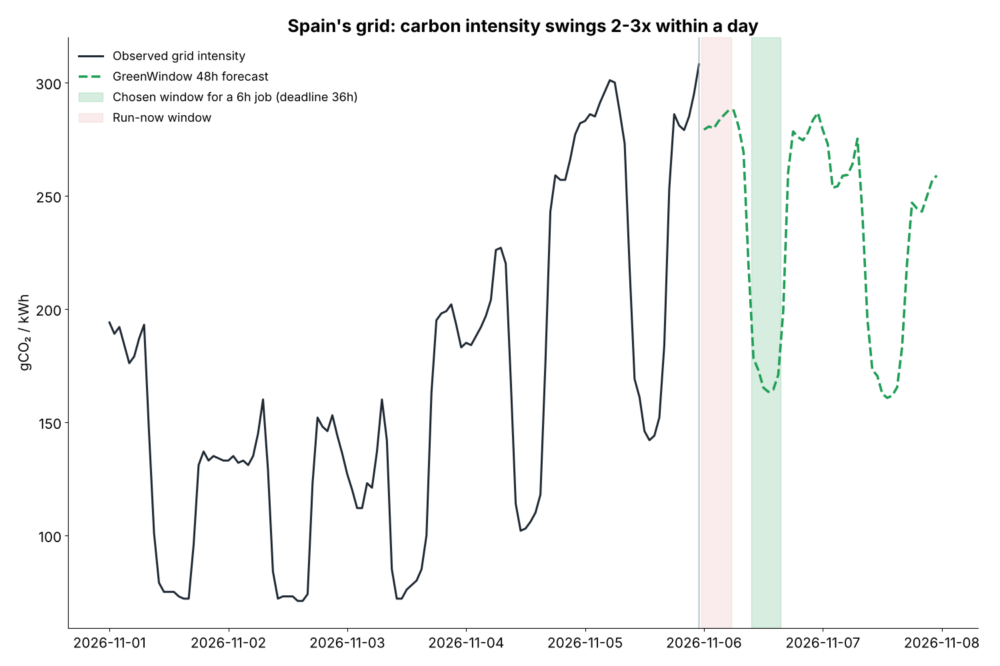
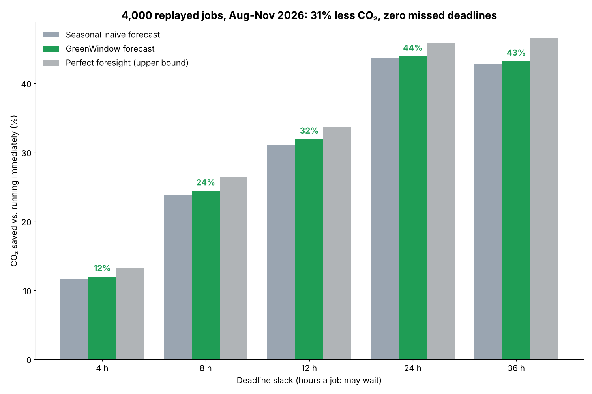

# GreenWindow

Carbon-aware scheduling for AI training and cloud batch jobs on Spain's electricity grid.

GreenWindow forecasts the grid's carbon intensity (gCO2/kWh) 48 hours ahead and moves flexible jobs into the lowest-carbon window that still meets their deadline.



## Results (held-out replay, 1 Aug to 5 Nov 2026)

| | CO2 saved vs. run-now |
|---|---|
| Seasonal-naive forecast | 30.9% |
| **GreenWindow** | **31.4%** (32.6% if jobs can checkpoint) |
| Perfect foresight (upper bound) | 33.5% |

- 4,000 simulated jobs (1 to 8 h, 4 to 36 h slack, 10 kW each), 0 missed deadlines
- GreenWindow reaches 94% of the perfect-foresight saving
- Forecast MAE over 1 to 48 h: 27.6 gCO2/kWh vs. 30.2 for the seasonal-naive baseline



## Data

- Spanish public net generation by source, 15-minute resolution, Nov 2025 to Nov 2026, from the Fraunhofer ISE Energy-Charts API (`api.energy-charts.info/public_power?country=es`).
- Hourly intensity = generation-weighted IPCC AR5 lifecycle emission factors (gas 490, coal 820, oil 650, biomass 230, waste 330, solar 45, hydro 24, nuclear 12, wind 11 gCO2/kWh). Imports, exports and storage charging are excluded.
- `data/es_carbon_intensity_hourly.csv`: 8,880 hourly values.

## Method

1. **Forecaster** (`greenwindow/forecast.py`): a direct multi-horizon gradient-boosted model (scikit-learn HistGradientBoosting with absolute-error loss). The features are level-free ratios to the trailing 24 h mean (last value, momentum, 7-day mean, same-hour on the last observed day, same hour one week earlier) plus calendar terms. Its output is blended 50/50 with the seasonal-naive forecast.
2. **Scheduler** (`greenwindow/scheduler.py`): for a job of length d and slack s, the scheduler takes the start offset in [0, s] that minimises forecast CO2 over the run (O(n) prefix sums). Interruptible jobs take the d cheapest hours instead.
3. **Backtest** (`backtest.py`): the model is trained on Nov 2025 to Jul 2026. Jobs in the test period are planned using only information available at release time, then charged at the intensity that actually occurred.

## Run

```bash
pip install -r requirements.txt
python backtest.py            # trains, evaluates, writes results/
python make_figures.py        # docs/*.png
python -m greenwindow.cli plan --duration 6 --deadline-hours 36
```

## Limitations

- Uses average intensity, not marginal intensity.
- Does not yet use day-ahead wind or solar forecasts.
- The 50/50 blend weight was fixed rather than tuned on a separate validation split.
- The job mix is synthetic.
